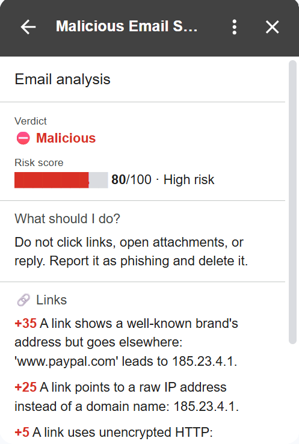
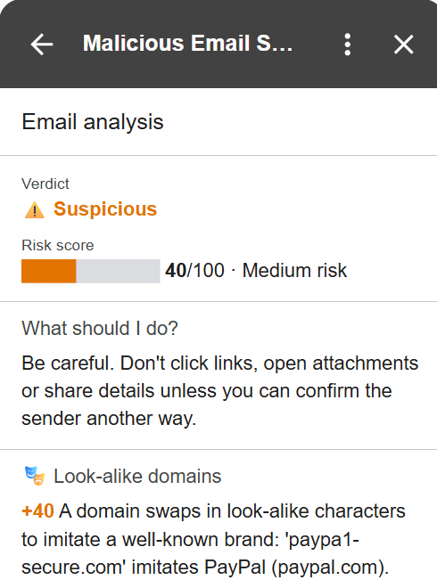

# Malicious Email Scorer

A Gmail Add-on that checks the email you open and tells you if it is **Safe**, **Suspicious** or **Malicious**, and why.

<table>
  <tr>
    <th>Phishing email</th>
    <th>Look-alike domain</th>
  </tr>
  <tr>
    <td valign="top"></td>
    <td valign="top"></td>
  </tr>
</table>

## How it works

```
Gmail Add-on (Apps Script)
reads the open email
        │
        │  HTTPS + API key
        ▼
Backend (Python, FastAPI on Render)
runs 6 analyzers and adds up a score
        │
        │  score + reasons
        ▼
Gmail Add-on shows the result card
```

- The **add-on** only collects data and shows the result.
- The **backend** does the analysis and logic.
- Attachment **contents are never sent**, only names, sizes and hashes.

## What it checks - 6 analayzers

**🔐 Sender authentication**\
Gmail says the email failed SPF, DKIM or DMARC.

**👤 Sender identity**\
The name says "PayPal" but the address is `x@paypa1-support.xyz`, or replies go to a private Gmail account.

**🔗 Links**\
The text shows `paypal.com` but the link goes to `185.23.4.1`. Also catches `bit.ly` links and tricks like `paypal.com@evil.xyz`.

**🎭 Look-alike domains**\
Domains that imitate a brand: `paypa1.com`, `rnicrosoft.com`, `amazom.com`, or Cyrillic letters that look like English ones.

**📎 Attachments**\
Dangerous files such as `invoice.pdf.exe`, `.js` scripts, Office files with macros, and file names that hide their real type.

**💬 Content**\
Pressure and scam phrases, in English and Hebrew:\
"Your account will be suspended", "חבילה ממתינה, יש לשלם דמי מכס".


## How the score works

- Every finding adds points. Strong signals (DMARC fail, `.exe`) add a lot; weak ones (the word "Immediately") add a little.
- **Score** = sum of points, max 100.
 **0–29 Safe · 30–69 Suspicious · 70–100 Malicious.**
- One strong signal makes an email *Suspicious*. It takes several to make it *Malicious*. This avoids false alarms.
- The card shows the points next to each reason, so the score is always explained.


## Security

- **Minimal permissions:** the add-on can only read the email that is open. It can only call the backend's URL (`urlFetchWhitelist`).
- **Email is untrusted input:** the backend rejects unknown fields and oversized values.
- **Links are never opened**, so the tool can't be tricked into visiting attacker URLs.
- **Fake headers are ignored:** only authentication results written by Gmail are trusted.
- **Secrets stay out of Git:** the API key lives in Render and in Apps Script properties. It is checked in constant time, and if it is missing the server rejects everything.


## Main decisions

**Which analyzers to build**\
There are many possible signals. I chose the six I found most important, the ones that catch the most common phishing tricks. 

**How many points each risk gets**\
Signals that are rare in legitimate email get high points: a failed sender check, a fake sender identity, a deceptive link or an `.exe` file. Content gets low points, because real emails also say "Immediately". The goal is to avoid false positives: a tool that warns about everything quickly gets ignored.

**FastAPI for the backend**\
I define a schema for the input (fields, types, maximum sizes), and FastAPI automatically blocks anything that doesn't match, before my code runs. This matters because email content is hostile input.

**Render for hosting**\
The add-on runs on Google's servers, so the backend needs a public HTTPS address. A tunnel from my laptop (like ngrok) gives an address that changes every time it restarts and only works while my laptop is on. Render gives a fixed address and redeploys on every `git push`. Downside of the free plan: it sleeps after 15 minutes, so the first request can be slow.


## Run it

The backend is already live at `https://malicious-email-scorer.onrender.com` and the add-on is installed on my Gmail account. I will demonstrate it live in the interview.

The API key is secret, so it is not in this repository. To run your own copy:

**1. Deploy the backend to Render**
- Create a new Web Service from this repository.
- Root Directory: `backend`
- Start Command: `uvicorn app.main:app --host 0.0.0.0 --port $PORT`
- In the Environment tab, add `API_KEY` and click **Generate**.

**2. Install the add-on**
- Copy the files from `addon/` into a new project at [script.google.com](https://script.google.com).
- In `appsscript.json`, change `urlFetchWhitelist` to your Render address.
- In **Project Settings → Script Properties**, add `BACKEND_URL` (your Render address) and `API_KEY` (the same key as on Render).
- Run `testBackendConnection` once to approve permissions.
- **Deploy → Test deployments → Install**.

**3. Open an email in Gmail** and click the add-on icon.

**Run the tests (optional, not needed for the add-on):**
```bash
cd backend
pip install -r requirements-dev.txt
pytest
```

## Project structure

```
addon/      Gmail Add-on (Code.gs, appsscript.json)
backend/
  app/
    main.py, security.py, schemas.py   API, API-key check, input rules
    scoring.py                         adds up the score
    analyzers/                         one file per analyzer
  tests/                               69 tests
```
